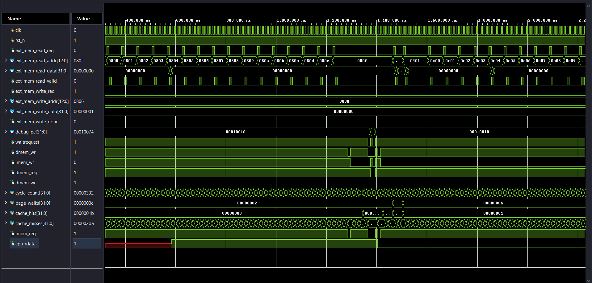
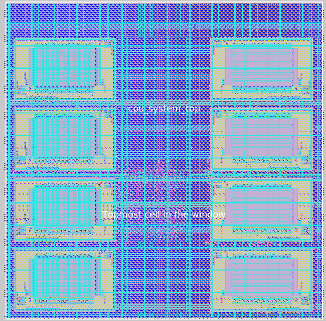

<!-- Replace the banner image link with your actual project banner -->

<h1 align="center">RV32I Pipelined Processor with VIPT Cache</h1>

 

  <b>A fully verified 5-stage pipelined RISC-V (RV32I) core featuring a hardware page walker, TLB, and a Virtually Indexed, Physically Tagged (VIPT) cache, physically implemented on the SkyWater 130nm node.</b>

 

## 📖 Table of Contents
- [✨ Key Features](#-key-features)
- [🏗️ Architecture Overview](#️-architecture-overview)
- [🛠️ Tech Stack & Tools](#️-tech-stack--tools)
- [🚀 Getting Started](#-getting-started)
- [📊 Physical Design Metrics](#-physical-design-metrics)
- [🤝 Acknowledgments](#-acknowledgments)

---

## ✨ Key Features

* **ISA Compliance:** Full support for the RISC-V RV32I base integer instruction set.
* **5-Stage Pipeline:** Classic instruction fetch, decode, execute, memory, and write-back stages with robust hazard detection and stall logic.
* **Advanced Memory Hierarchy:** Integrated Virtually Indexed, Physically Tagged (VIPT) cache for highly parallel TLB lookups and cache access.
* **MMU & Page Walker:** Hardware-managed page tables supporting fast virtual-to-physical address translation.
* **ASIC Ready:** Full RTL-to-GDSII flow completed. Clean LVS, 0 DRC violations, and timing closure (setup/hold) using OpenLane.

## Simulation Waveform

> `

## 🏗️ Architecture Overview

The `cpu_system_top` module integrates the core CPU datapath with the memory subsystem. The design successfully incorporates 8 pre-compiled 2 KiB SRAM macros (`sky130_sram_2kbyte_1rw1r_32x512_8`) efficiently placed to minimize wire routing congestion and wide-metal (`met3.3d`) DRC rules.

> 
>

## 🛠️ Tech Stack & Tools

This project heavily relies on open-source Electronic Design Automation (EDA) tools and industry-standard simulation environments:

### Design & Verification
* **SystemVerilog / Verilog:** Core RTL design and testbench development.
* **Vivado / QuestaSim / VCS:** Functional simulation, synthesis, and hazard logic verification.

### Physical Design (ASIC Flow)
* **PDK:** SkyWater 130nm Open-Source PDK.
* **OpenLane / OpenROAD:** Automated RTL-to-GDSII pipeline (global placement, CTS, detailed routing).
* **Yosys:** Logic synthesis and optimization.
* **Magic / KLayout:** GDSII layout viewing, signoff DRC verification, and mask inspection.
* **Netgen:** Layout Versus Schematic (LVS) checking.

## 🚀 Getting Started

### Prerequisites
Ensure you have the following installed on an Ubuntu-based development environment:
* [OpenLane](https://github.com/The-OpenROAD-Project/OpenLane) (v2 or v1 depending on your setup)
* Magic VLSI Layout Tool
* RISC-V GNU Compiler Toolchain
